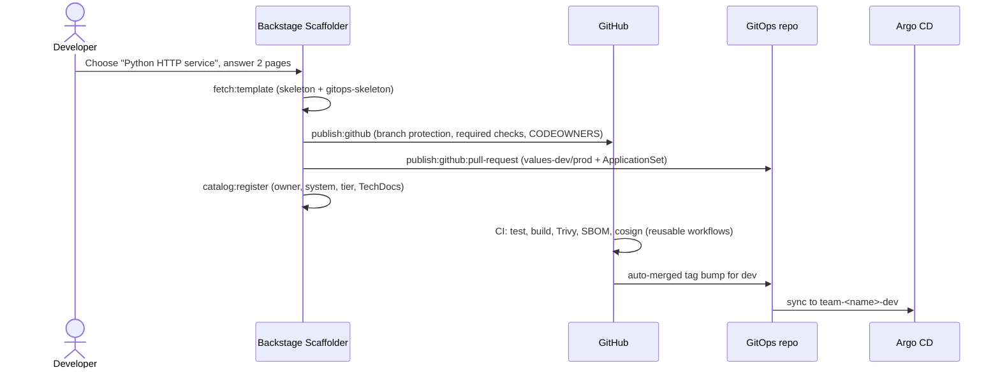

# backstage-golden-path-templates

[](https://github.com/vince-sre/backstage-golden-path-templates/actions/workflows/ci.yml)


Backstage **Software Templates** for the two golden paths I reach for most:
a production-ready service and a reusable Terraform module. They follow the
platform-engineering patterns I've used in production: templates encode the
paved road (CI, security scanning, deployment, ownership, docs), so a new
service is compliant on day one rather than after a hardening ticket.

These templates tie the rest of this portfolio together. The generated service builds with
[cicd-pipeline-templates](https://github.com/vince-sre/cicd-pipeline-templates), deploys
through [gitops-argocd-platform](https://github.com/vince-sre/gitops-argocd-platform), and is
measured with the SLO pattern in [k8s-observability-stack](https://github.com/vince-sre/k8s-observability-stack).



## Templates

### `python-service`
| Generated | Details |
|---|---|
| App | Stdlib HTTP starter with `/healthz`, `/readyz` (503 when not ready) and `/metrics` (Prometheus), plus tests |
| Container | Slim, non-root (UID 10001) Dockerfile with a healthcheck |
| CI | Lint and test, then the shared **build, scan, SBOM and sign** workflow, then **auto-promote to dev** via GitOps PR |
| Repo settings | Default-branch protection, required `test` check, CODEOWNERS mapped to the owning team |
| Deployment | PR to the GitOps repo: per-env values for the shared Helm chart and an ApplicationSet (dev/prod) |
| Catalog and docs | `catalog-info.yaml` (owner, system, tier, Argo CD and Prometheus annotations), TechDocs with overview and runbook |
| Tier | Tier 1/2/3 picks the documented SLO (99.9 / 99.5 / 99%), prod replicas and max scale |

### `terraform-module`
| Generated | Details |
|---|---|
| Module | Provider-specific (`aws`, `google`, `azurerm`) naming and tagging base that every module needs; standard tags can't be overridden by callers; GCP gets label normalisation |
| Quality | Pinned provider versions, input validation, an `examples/basic` that CI plans |
| CI | `fmt -check`, `init/validate` for module and examples, `tflint` (recommended preset), credential-free plan |

## Design decisions

- **Templates call shared workflows; they don't copy them.** Generated CI is about 50 lines
  that call versioned reusable workflows (`@v1`). Pipeline fixes reach every service without a mass PR.
- **Deployment is a PR, not a direct write.** The template proposes the GitOps change, so
  platform reviewers and branch protection still apply, and onboarding is auditable.
- **Ownership is mandatory.** `owner` is required and flows into the catalog, CODEOWNERS and tags.
  Unowned services are how incidents end up with nobody to page.
- **Templating collisions are handled explicitly.** GitHub Actions `${{ }}` and ApplicationSet
  `{{ }}` expressions are wrapped in `` so Nunjucks leaves them alone, and the tests assert they survive rendering.
- **Templates are tested like code.** Broken templates usually fail at click time, in front of
  the developer. Here CI catches that first (see below).

## Validation

`./scripts/validate.sh` (and CI) runs:

| Check | How |
|---|---|
| Template and catalog schema | Official Backstage JSON schemas (pinned release), Draft-07 with `$ref` resolution |
| Wiring | Every `parameters.x` is declared; every skeleton `values.x` is passed by its `fetch:template` step (and nothing unused is passed); step-output references point at real step ids |
| Rendering | A Jinja2 environment configured like Backstage's Nunjucks (`${{ }}`, StrictUndefined) renders file contents **and** paths for several answer sets |
| Rendered service | YAML parses, `catalog-info` validates as a Component, **actionlint** on the generated workflow, the generated app's **own pytest suite** and **ruff** pass |
| Rendered GitOps | ApplicationSet passes **kubeconform** (CRD catalog); Go templates kept literal; tier-dependent values correct |
| Rendered Terraform | For each provider: `fmt`, `init`, `validate`, `tflint`, `plan` of the example |

The tests already caught a real bug while I was building this: the service skeleton used
`values.gitopsRepo`, but the template didn't pass it (see the commit history).

## Use it

```yaml
# app-config.yaml
catalog:
  locations:
    - type: url
      target: https://github.com/vince-sre/backstage-golden-path-templates/blob/main/catalog/all.yaml
      rules:
        - allow: [Template, Group, System, Location]
```

Render locally without Backstage:

```bash
pip install -r requirements-dev.txt
python3 scripts/render.py templates/python-service/skeleton /tmp/orders \
  name=orders description="Orders API" owner=group:default/team-orders system=commerce \
  tier=tier-1 repoSlug=vince-sre/orders image=ghcr.io/vince-sre/orders gitopsRepo=vince-sre/gitops-argocd-platform
cd /tmp/orders && python -m pytest -q
```

## What this demonstrates

Internal developer platform thinking: paved roads that make the secure, observable,
GitOps-deployed path the easiest one; ownership and service tiers built in; and
treating templates as tested, versioned software.

## License

MIT
